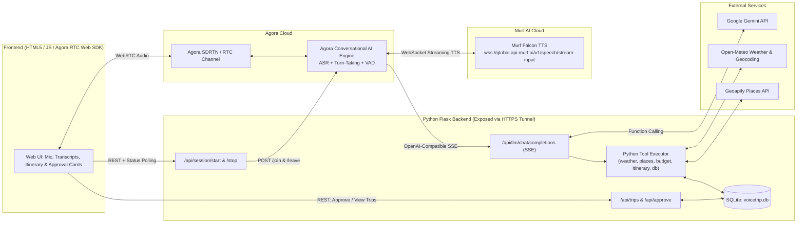

# Technical Requirements Document (TRD)
## VoiceTrip AI (YatraPilot AI) — Architecture & Integration Specification

**Document ID:** TRD-VOICETRIP-001  
**Version:** 1.0  
**Related Documents:** `01_PRD_VoiceTrip_AI.md`, `03_SRD_VoiceTrip_AI.md`, `04_FRD_VoiceTrip_AI.md`  
**Target Build Window:** ~8 Hours (Hackathon MVP)  

---

## 1. Technical Overview

This Technical Requirements Document (TRD) specifies **how** VoiceTrip AI (YatraPilot AI) is engineered. It defines the system architecture, verified integration mechanisms for **Agora Conversational AI Engine**, **Murf AI Falcon TTS**, and **Google Gemini**, the Python Flask backend, SQLite persistence, external API integrations, security controls, and an 8-hour execution plan.

### Key Architectural Finding (Agora + Murf + Gemini Compatibility)
Based on official Agora and Murf documentation:
1. **Agora ↔ Murf Falcon TTS:** Agora Conversational AI Engine natively supports Murf TTS via WebSockets (`wss://global.api.murf.ai/v1/speech/stream-input`) configured directly inside the Agora `join` API's `tts` block (`vendor: "murf"`, `model: "FALCON"`). The Flask backend does **not** manually call Murf's TTS endpoint or stream raw audio bytes into Agora.
2. **Agora ↔ Gemini + Python Tool Calling:** While Agora supports passing Gemini directly as a managed/BYOK LLM (`style: "gemini"`), Agora's native `llm.tools` feature explicitly notes that Custom LLMs are not used with `llm.tools`, and `llm.tools` requires separate public HTTPS endpoints per tool with no `PUT`/`PATCH`/`DELETE` or server-side session orchestration. Therefore, for a Python Flask MVP where **Python functions implement the agent's tools, SQLite state, and Human-in-the-Loop (HITL) approval**, the recommended architecture uses **Agora's Custom LLM protocol** ([Connect your own LLM service](https://docs.agora.io/en/ai/build/custom-model-integration/custom-llm)): Flask exposes an OpenAI Chat Completions-compatible SSE endpoint (`/api/llm/chat/completions`) that invokes **Google Gemini** (`google-genai` SDK) with Python tool calling and streams the final spoken text back to Agora.

---

## 2. Technology Stack and Justification

| Layer | Technology | Justification & Compatibility Notes |
| :--- | :--- | :--- |
| **Frontend** | HTML5, CSS3, Vanilla JavaScript + Agora RTC Web SDK (`agora-rtc-sdk-ng`) | Zero build-step overhead; browser mic capture and real-time Agora audio playback in <150 lines of JS. |
| **Backend** | Python 3.11+ with **Flask** (`flask`, `flask-cors`) | Matches preferred stack; `threaded=True` (or `gunicorn` gthread) handles concurrent SSE streaming for Agora Custom LLM + UI polling/REST calls without FastAPI/microservice complexity. |
| **Voice Transport & Runtime** | **Agora Conversational AI Engine** + **Agora RTC** | Handles ultra-low-latency WebRTC audio transport (SDRTN®), VAD, turn-taking, interruption handling, and ASR (`deepgram` managed mode). |
| **Text-to-Speech (TTS)** | **Murf AI Falcon TTS** (`model: "FALCON"`) | Natively supported by Agora Conversational AI Engine via `wss://global.api.murf.ai/v1/speech/stream-input`; delivers <100ms time-to-first-audio (per Murf Falcon 2.1 docs). |
| **AI Reasoning & Tool Calling** | **Google Gemini API** (`google-genai` Python SDK) | Called by Flask inside the Custom LLM endpoint; supports native function calling (`get_weather`, `search_attractions`, `estimate_trip_budget`, `generate_itinerary`, `save_trip`, `update_itinerary`). |
| **External Weather API** | **Open-Meteo** (Geocoding + Forecast API) | Free, no API key required, reliable JSON REST API with up to 16-day forecasts. |
| **External Attractions API** | **Geoapify Places API** | Free tier (3,000 credits/day, no credit card), category-filtered POI discovery by coordinates. |
| **Database** | **SQLite** (`sqlite3` standard library) | Zero-setup file-based relational DB (`voicetrip.db`) for trips, itineraries, tool logs, and approval states. |
| **Config & Secrets** | `python-dotenv` | Loads `.env` credentials cleanly without hardcoding keys. |

---

## 3. System Architecture

The architecture strictly separates four distinct layers:
1. **Voice Transport & Conversation Layer (Agora RTC + Conversational AI Engine):** Captures user audio, performs ASR, manages turn-taking/barge-in, and routes synthesized audio back to the browser.
2. **Speech Synthesis Layer (Murf AI Falcon TTS):** Connected directly to Agora Conversational AI Engine over WebSocket (`wss://global.api.murf.ai/v1/speech/stream-input`) to convert streamed LLM text into natural speech.
3. **Reasoning & Orchestration Layer (Flask Custom LLM Bridge + Google Gemini API):** Receives conversation messages from Agora via OpenAI-compatible SSE, runs Gemini reasoning + multi-step function calling, and enforces HITL approval gates.
4. **Action-Execution & Persistence Layer (Python Tool Functions + External APIs + SQLite):** Executes deterministic API calls (Open-Meteo, Geoapify), budget math, itinerary generation, and SQLite CRUD operations.

---

## 4. High-Level Architecture Diagram



---

## 5. Component Architecture

| Component | Module / File | Responsibility |
| :--- | :--- | :--- |
| **Web Client** | `static/app.js`, `templates/index.html` | Agora RTC join/leave, mic mute/unmute, live state polling (`/api/session/state`), itinerary rendering, HITL approval buttons. |
| **Flask App Entry** | `app.py` | Initializes Flask, SQLite schema, routes for session lifecycle, Custom LLM SSE, and trip/approval endpoints. |
| **Agora Client** | `services/agora_service.py` | Generates RTC tokens, calls Agora Conversational AI `join` and `leave` REST endpoints. |
| **Gemini Agent Orchestrator** | `services/agent_service.py` | Translates OpenAI-format `messages` to Gemini format, runs Gemini function-calling loop, emits SSE chunks + Agora `custom_metadata`. |
| **Travel Tools** | `tools/travel_tools.py` | Implements the 6 core Python tools (`get_weather`, `search_attractions`, `estimate_trip_budget`, `generate_itinerary`, `save_trip`, `update_itinerary`). |
| **Data Access Layer** | `db/database.py` | SQLite connection helper, schema migration, CRUD for `trips`, `session_state`, and `tool_logs`. |

---

## 6. Frontend Architecture

- **Agora RTC Web SDK (`AgoraRTC`):** Loaded via CDN (`https://download.agora.io/sdk/release/AgoraRTC_N.js`). Joins channel with `appId`, `channel`, `token`, and `uid` returned by `POST /api/session/start`.
- **Audio Handling:** Creates local microphone track (`AgoraRTC.createMicrophoneAudioTrack()`), publishes to channel, and subscribes to `user-published` events to play remote Murf Falcon audio (`user.audioTrack.play()`).
- **UI State Synchronization:** Polls `GET /api/session/state?channel=<channel>` every 1.5 seconds (simple, zero-WebSocket-complexity for 8h MVP) to display:
  - Live tool-call activity badges (e.g., *"Fetching Coorg weather..."*).
  - Current draft/saved itinerary cards & cost breakdown.
  - **Pending Approval Banner** when `pending_approval` is active, allowing the user to click **Approve** or **Reject** (in addition to speaking *"Yes, save it"*).

---

## 7. Backend Architecture

- Single-process **Python Flask** server (`app.py`) running with `threaded=True` (or `gunicorn -w 1 --threads 8` for deployment).
- **Why single-process?** SQLite handles single-writer concurrency cleanly in one process, and in-memory/DB session state stays immediately consistent across `/api/llm/chat/completions` (called by Agora Cloud) and `/api/session/state` (polled by Browser UI).

---

## 8. AI Agent Architecture

The agent uses a **ReAct-style single-agent tool-calling loop** powered by Google Gemini:
1. Receives conversation history from Agora's `POST /api/llm/chat/completions`.
2. Injects a structured **System Prompt** enforcing:
   - Concise, natural spoken responses (no markdown tables or asterisks read aloud).
   - Mandatory tool usage for weather, attractions, and budgets (never invent data).
   - Mandatory **Human-in-the-Loop** confirmation before calling `save_trip` or `update_itinerary` (or when `approved=false`).
   - Strict prohibition on claiming real-world bookings occurred.
3. Loops up to `MAX_TOOL_ITERATIONS = 5` per turn until Gemini produces a final spoken response, then streams it as OpenAI-compatible SSE chunks.

---

## 9. Agora Integration Architecture

Verified against [Start and stop an agent | Agora Docs](https://docs.agora.io/en/ai/build/start-stop-agent):
- **Endpoint (Start):** `POST https://api.agora.io/api/conversational-ai-agent/v2/projects/{AGORA_APP_ID}/join`
- **Endpoint (Stop):** `POST https://api.agora.io/api/conversational-ai-agent/v2/projects/{AGORA_APP_ID}/agents/{agent_id}/leave`
- **Authentication:** HTTP Basic Auth header `Authorization: Basic <base64(AGORA_CUSTOMER_ID:AGORA_CUSTOMER_SECRET)>`
- **ASR Block:** Uses Agora-managed Deepgram (`"credential_mode": "managed"`, `"vendor": "deepgram"`, `"params": {"model": "nova-3", "language": "en-US"}`) so no separate STT key is needed.
- **LLM Block:** Points to Flask's public HTTPS URL (`"url": "<PUBLIC_BASE_URL>/api/llm/chat/completions"`, `"api_key": "<INTERNAL_LLM_BEARER_TOKEN>"`).
- **Idle Timeout:** `idle_timeout: 180` seconds to auto-cleanup orphaned hackathon sessions.

---

## 10. Murf Falcon TTS Integration Architecture

Verified against [Murf | Agora Docs](https://docs.agora.io/en/ai/models/tts/murf) and [Agora and Murf | Murf API Docs](https://murf.ai/api/docs/integrations/agora):
- Configured inside the `properties.tts` object of the Agora `/join` request:
```json
"tts": {
  "vendor": "murf",
  "params": {
    "api_key": "<MURF_API_KEY>",
    "base_url": "wss://global.api.murf.ai/v1/speech/stream-input",
    "voiceId": "Matthew",
    "locale": "en-US",
    "rate": 0,
    "pitch": 0,
    "model": "FALCON",
    "sample_rate": 24000
  }
}
```
- **Verification Note:** Available `voiceId` and `locale` values for Falcon 2.1 should be verified against the active Murf API key in the Murf API Dashboard before the live demo.

---

## 11. Gemini API Integration

- Uses the official `google-genai` Python SDK (`from google import genai`).
- **Recommended Model:** `gemini-2.5-flash` (or `gemini-3.6-flash` / `gemini-4-hydrogen` per Google AI Studio availability — *mark exact model string for verification against the developer's AI Studio key*).
- **Function Calling:** Tools are registered as Python functions / `types.FunctionDeclaration` schemas. Gemini decides which tools to call and in what order (e.g., `get_weather` + `search_attractions` in parallel or sequence, followed by `estimate_trip_budget` and `generate_itinerary`).

---

## 12. Tool-Calling Mechanism

Each of the 6 required tools is implemented in `tools/travel_tools.py` and exposed to Gemini:

1. `get_weather(destination: str, date: str) -> dict`
2. `search_attractions(destination: str, preferences: list[str]) -> dict`
3. `estimate_trip_budget(destination: str, duration: int, travellers: int) -> dict`
4. `generate_itinerary(destination: str, dates: str, budget: float, preferences: list[str]) -> dict`
5. `save_trip(trip_details: dict, user_confirmed: bool = False) -> dict`
6. `update_itinerary(trip_id: int, changes: dict, user_confirmed: bool = False) -> dict`

**HITL Guardrail in Code:** `save_trip` and `update_itinerary` inspect `user_confirmed`. If `False`, the Python tool **refuses to write to SQLite**, writes a `pending_approval` record to `session_state`, and returns `{"status": "APPROVAL_REQUIRED", "message": "Ask the user to confirm before saving."}` to Gemini.

**Latency UX:** When Gemini triggers a tool call, `/api/llm/chat/completions` can emit an Agora `chat.completion.custom_metadata` SSE packet (`interruptable: false`) with a brief spoken filler (*"Let me check the weather and top spots for you..."*) before executing the HTTP calls. *(Note: Test interruption behavior during integration to ensure smooth playback.)*

---

## 13. External API Integrations

| API | Endpoint | Auth | Rate Limit / Quota | Known Limitations |
| :--- | :--- | :--- | :--- | :--- |
| **Open-Meteo Geocoding** | `GET https://geocoding-api.open-meteo.com/v1/search?name={city}&count=1` | None | Free (non-commercial) | Ambiguous city names return top match; handle empty `results` array. |
| **Open-Meteo Forecast** | `GET https://api.open-meteo.com/v1/forecast?latitude={lat}&longitude={lon}&daily=temperature_2m_max,temperature_2m_min,precipitation_probability_max,weathercode&timezone=auto&forecast_days=16` | None | Free (non-commercial) | **Max 16-day forecast window.** Dates >16 days ahead return an explicit `out_of_range` notice; no live forecast fabricated. |
| **Geoapify Places** | `GET https://api.geoapify.com/v2/places?categories={cats}&filter=circle:{lon},{lat},15000&limit=10&apiKey={KEY}` | Query `apiKey` | 3,000 credits/day (Free) | Returns POI name, address, category, coordinates. Does **not** provide live ticket prices, opening hours guarantees, or booking links. |

---

## 14. Database Architecture

SQLite (`voicetrip.db`) with 3 lightweight tables:
1. `trips`: Stores saved itineraries, budgets, weather snapshots, and status (`DRAFT`, `SAVED`, `UPDATED`).
2. `session_state`: Tracks active Agora channel state, latest tool results, active itinerary JSON, and `pending_approval` payload for UI synchronization.
3. `tool_logs`: Audit trail of every tool invocation, arguments, latency, and success/error status for debugging and demo verification.

---

## 15. Database Schema

```sql
CREATE TABLE IF NOT EXISTS trips (
    id INTEGER PRIMARY KEY AUTOINCREMENT,
    channel_name TEXT NOT NULL,
    destination TEXT NOT NULL,
    start_date TEXT,
    duration_days INTEGER NOT NULL,
    travellers INTEGER NOT NULL DEFAULT 1,
    budget_amount REAL,
    currency TEXT DEFAULT 'INR',
    preferences_json TEXT,
    weather_summary_json TEXT,
    attractions_json TEXT,
    itinerary_json TEXT NOT NULL,
    status TEXT NOT NULL DEFAULT 'SAVED',
    created_at TIMESTAMP DEFAULT CURRENT_TIMESTAMP,
    updated_at TIMESTAMP DEFAULT CURRENT_TIMESTAMP
);

CREATE TABLE IF NOT EXISTS session_state (
    channel_name TEXT PRIMARY KEY,
    agent_id TEXT,
    active_itinerary_json TEXT,
    pending_approval_json TEXT,
    last_tools_json TEXT,
    transcript_json TEXT,
    updated_at TIMESTAMP DEFAULT CURRENT_TIMESTAMP
);

CREATE TABLE IF NOT EXISTS tool_logs (
    id INTEGER PRIMARY KEY AUTOINCREMENT,
    channel_name TEXT NOT NULL,
    tool_name TEXT NOT NULL,
    arguments_json TEXT NOT NULL,
    result_summary TEXT,
    status TEXT NOT NULL,
    latency_ms INTEGER,
    created_at TIMESTAMP DEFAULT CURRENT_TIMESTAMP
);
```

---

## 16. API Design

| Method | Endpoint | Caller | Purpose |
| :--- | :--- | :--- | :--- |
| `GET` | `/health` | Dev / Tunnel | Health check (`{"status": "ok"}`) |
| `POST` | `/api/session/start` | Browser UI | Generates Agora RTC token, calls Agora `/join` with Murf + Custom LLM, returns `{appId, channel, token, uid, agentId}` |
| `POST` | `/api/session/stop` | Browser UI | Calls Agora `/leave` to stop agent and cleans up session |
| `GET` | `/api/session/state` | Browser UI | Returns active itinerary, recent tool logs, transcript snippets, and `pending_approval` |
| `POST` | `/api/llm/chat/completions` | Agora Cloud | OpenAI-compatible SSE endpoint invoking Gemini + Python tools |
| `POST` | `/api/approve` | Browser UI | Confirms or rejects a `pending_approval` action (e.g., saves trip to SQLite) |
| `GET` | `/api/trips` | Browser UI | Lists all saved trips from SQLite |
| `GET` | `/api/trips/<int:trip_id>` | Browser UI | Retrieves a specific saved trip |

---

## 17. Request / Response Examples

### `POST /api/session/start`
**Request:**
```json
{
  "user_uid": "1002"
}
```
**Response (`200 OK`):**
```json
{
  "app_id": "your_agora_app_id",
  "channel": "voicetrip_a1b2c3d4",
  "token": "007eJx...",
  "uid": 1002,
  "agent_id": "1NT29X10YHxxxxxWJOXLYHNYB"
}
```

### `POST /api/llm/chat/completions` (Agora → Flask → SSE Stream)
**Response (`text/event-stream`):**
```text
data: {"id":"chatcmpl-1","object":"chat.completion.chunk","choices":[{"index":0,"delta":{"role":"assistant","content":"I checked Coorg's forecast for Friday—expect light afternoon showers. "},"finish_reason":null}]}

data: {"id":"chatcmpl-1","object":"chat.completion.chunk","choices":[{"index":0,"delta":{"content":"Would you like me to save this 3-day itinerary?"},"finish_reason":"stop"}]}

data: [DONE]
```

---

## 18. Environment Variables

Stored in `.env` and loaded via `python-dotenv`:
```ini
AGORA_APP_ID=
AGORA_APP_CERTIFICATE=
AGORA_CUSTOMER_ID=
AGORA_CUSTOMER_SECRET=
MURF_API_KEY=
MURF_VOICE_ID=Matthew
MURF_LOCALE=en-US
GEMINI_API_KEY=
GEMINI_MODEL=gemini-2.5-flash
GEOAPIFY_API_KEY=
PUBLIC_BASE_URL=https://your-ngrok-url.ngrok-free.app
CUSTOM_LLM_SECRET=local-dev-secret-token
FLASK_PORT=5000
```

---

## 19. Security Considerations

- **Secret Isolation:** All API keys (`MURF_API_KEY`, `GEMINI_API_KEY`, `AGORA_CUSTOMER_SECRET`, `GEOAPIFY_API_KEY`) live strictly in `.env` on the Flask server; never exposed to `app.js`.
- **Custom LLM Auth:** `/api/llm/chat/completions` validates the `Authorization: Bearer <CUSTOM_LLM_SECRET>` header passed via Agora's `llm.api_key` field.
- **SQL Injection Prevention:** All SQLite queries use parameterized `?` placeholders.
- **No Unapproved Mutations:** `save_trip` and `update_itinerary` enforce `user_confirmed=True` in Python code, independent of LLM prompt compliance.

---

## 20. Error Handling

- **External API Timeouts:** All `requests.get()` calls to Open-Meteo and Geoapify use `timeout=5`. Timeouts or non-200 responses return structured JSON `{"error": "WEATHER_API_UNAVAILABLE", "fallback_hint": "..."}` so Gemini informs the user honestly.
- **Agora `/join` Failure:** Returns HTTP `502` with clear diagnostic message to the UI (e.g., invalid credentials or token error).
- **Gemini Rate Limit / Error:** Catches SDK exceptions and emits a valid SSE error message (*"I'm having trouble reaching my planning engine right now—please try again in a moment."*) followed by `data: [DONE]`.

---

## 21. Logging and Debugging

- Python `logging` configured at `INFO` level to stdout + `voicetrip.log`.
- Every tool execution is persisted in `tool_logs` with `tool_name`, `arguments_json`, `status`, and `latency_ms` for instant demo verification.

---

## 22. Deployment Architecture

- **Hackathon Local + Tunnel (Fastest):** Run `python app.py` on port `5000` + `ngrok http 5000` (set `PUBLIC_BASE_URL` to the HTTPS ngrok URL).
- **Cloud Option (Optional):** Single-container deployment on Render or Railway (`gunicorn app:app --workers 1 --threads 8 --bind 0.0.0.0:$PORT`).

---

## 23. Testing Strategy

- **Unit Tests (`pytest`):** Mock Open-Meteo and Geoapify responses to test `get_weather`, `search_attractions`, `estimate_trip_budget`, and SQLite `save_trip`/`update_itinerary`.
- **SSE Contract Test:** `curl -N -X POST https://<PUBLIC_BASE_URL>/api/llm/chat/completions` to verify valid OpenAI SSE streaming before connecting Agora.
- **End-to-End Voice Dry Run:** Execute the 5-stage demo script via browser mic and verify `tool_logs` and `trips` table entries.

---

## 24. Performance Considerations

- **Connection Pooling:** Reuse `requests.Session()` for Open-Meteo and Geoapify calls.
- **City Cache:** Cache geocoding + weather results in memory for 15 minutes to speed up follow-up itinerary updates.
- **Concise Spoken Responses:** Instruct Gemini to keep voice replies under 3–4 sentences per turn so Murf Falcon TTS finishes speaking quickly.

---

## 25. 8-Hour Implementation Strategy

| Hours | Milestone | Deliverable |
| :--- | :--- | :--- |
| **0:00 – 1:00** | Project setup, `.env`, SQLite schema (`db/database.py`), Flask skeleton | Running `/health` + SQLite initialized |
| **1:00 – 2:30** | Implement & unit-test `travel_tools.py` (Open-Meteo, Geoapify, budget, itinerary, SQLite CRUD) | Verified 6 Python tools |
| **2:30 – 4:30** | Implement Gemini orchestrator + `/api/llm/chat/completions` SSE endpoint + ngrok tunnel | Verified SSE + tool calling via `curl` |
| **4:30 – 6:00** | Implement Agora `/api/session/start` & `/stop` with Murf Falcon TTS + HTML5/JS Agora RTC UI | Live two-way voice conversation |
| **6:00 – 7:15** | Build UI cards (transcript, tool badges, itinerary, HITL Approval banner, saved trips list) | Full end-to-end UI + voice sync |
| **7:15 – 8:00** | End-to-end rehearsal of 5-stage demo + error-handling test (out-of-range date / API failure) | Demo-ready hackathon submission |
