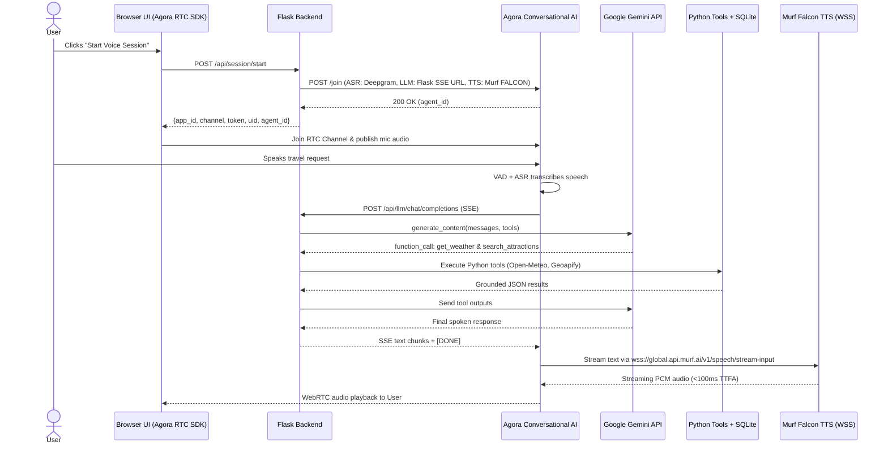
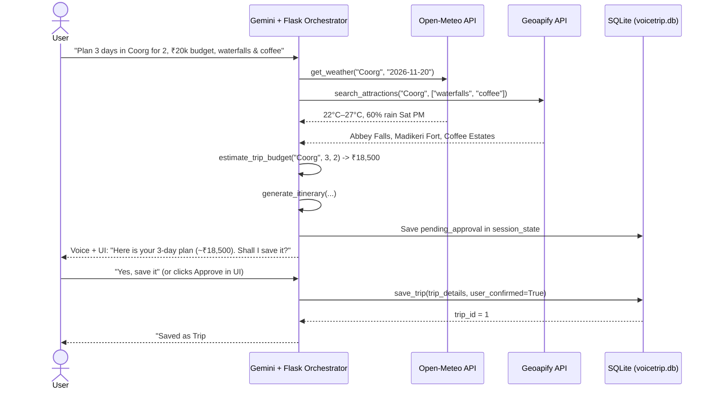

# Functional Requirements Document (FRD)
## VoiceTrip AI (YatraPilot AI) — Implementation-Ready Functional Specifications

**Document ID:** FRD-VOICETRIP-001  
**Version:** 1.0  
**Related Documents:** `01_PRD_VoiceTrip_AI.md`, `02_TRD_VoiceTrip_AI.md`, `03_SRD_VoiceTrip_AI.md`  

---

## 1. Functional Overview

This Functional Requirements Document (FRD) specifies **how** each user-facing and system-facing function of **VoiceTrip AI (YatraPilot AI)** behaves at runtime. It provides step-by-step workflows, Mermaid sequence diagrams, input/output contracts, UI screen specifications, edge cases, and acceptance tests ready for immediate 8-hour MVP implementation.

---

## 2. Actors and Roles

| Actor | Role |
| :--- | :--- |
| **Traveler (User)** | Speaks travel requests, answers follow-up questions, reviews UI cards, and approves/rejects critical actions. |
| **Web Client (`app.js`)** | Captures microphone audio via Agora RTC Web SDK, plays Murf audio, polls session state, and renders UI cards. |
| **Agora Conversational AI Engine** | Transcribes user speech (ASR), sends conversation turns to Flask Custom LLM, and streams Murf Falcon TTS audio back to the RTC channel. |
| **Flask Agent Orchestrator (`agent_service.py`)** | Bridges Agora SSE requests to Google Gemini, executes Python tools, enforces HITL gates, and updates SQLite. |
| **External APIs** | Open-Meteo (weather + geocoding) and Geoapify (attractions). |

---

## 3. Sequence Diagrams

### 3.1 Agora + Murf Falcon + Gemini Voice Integration Sequence

### 3.2 Main Agentic Planning & HITL Approval Workflow

---

## 4. Functional Modules

1. **Module A — Session & Voice Control (`FRD-FEAT-001`)**
2. **Module B — Conversational NLU & Preference Collection (`FRD-FEAT-002`)**
3. **Module C — External Research Tools (`FRD-FEAT-003`, `FRD-FEAT-004`)**
4. **Module D — Planning & Budget Engine (`FRD-FEAT-005`, `FRD-FEAT-006`)**
5. **Module E — Human-in-the-Loop & Persistence (`FRD-FEAT-007`, `FRD-FEAT-008`, `FRD-FEAT-009`)**
6. **Module F — Error Handling & Companion UI (`FRD-FEAT-010`, `FRD-FEAT-011`)**

---

## 5. Detailed Feature Specifications

### FRD-FEAT-001: Voice Session Start & Stop
- **Feature ID:** `FRD-FEAT-001`
- **Feature Name:** Real-Time Voice Conversation Lifecycle
- **Description:** Starts and stops a bidirectional Agora RTC voice session connected to an Agora Conversational AI agent using Murf Falcon TTS.
- **Preconditions:** Valid `.env` credentials; `PUBLIC_BASE_URL` reachable by Agora Cloud; browser microphone permission granted.
- **Input:** User clicks **Start Voice Session** (`POST /api/session/start`) or **End Session** (`POST /api/session/stop`).
- **Processing Logic:**
  1. Generate unique channel name (`voicetrip_<uuid8>`) and RTC token for user UID `1002` and agent UID `0`.
  2. Call Agora `/join` with `asr` (Deepgram `nova-3`), `llm` (Custom LLM URL `<PUBLIC_BASE_URL>/api/llm/chat/completions`), and `tts` (`vendor: "murf"`, `model: "FALCON"`).
  3. Initialize `session_state` row in SQLite.
  4. Return `{app_id, channel, token, uid, agent_id}` to browser; browser joins channel and publishes mic track.
  5. On stop, browser leaves channel and calls `/api/session/stop` which invokes Agora `/leave`.
- **Output:** Active audio stream and UI status `"Connected — Listening"`.
- **Postconditions:** Agent joins/leaves cleanly; `session_state` updated.
- **Error Conditions:** Mic denied in browser → display toast; Agora `/join` 4xx/5xx → return HTTP 502 with error details.
- **Acceptance Criteria:** Voice greeting from Murf Falcon plays within 3 seconds of clicking Start.

---

### FRD-FEAT-002: Travel Preference Collection
- **Feature ID:** `FRD-FEAT-002`
- **Feature Name:** Conversational Travel Preference Extraction
- **Description:** Extracts destination, start date/duration, budget, traveler count, and activity preferences across multi-turn dialogue.
- **Preconditions:** Active voice session.
- **Input:** Natural-language user speech transcribed by Agora ASR.
- **Processing Logic:**
  1. Gemini inspects conversation history.
  2. If `destination` or `duration` is missing, Gemini asks a concise clarifying question before calling planning tools.
  3. Defaults `travellers=1` if unspecified unless group size is mentioned; confirms budget/preferences naturally.
- **Output:** Structured parameters passed to tool calls or a concise spoken follow-up question.
- **Postconditions:** Extracted preferences reflected in subsequent tool arguments.
- **Error Conditions:** Unclear audio/empty transcript → Agora `ignore_empty` or Gemini asks user to repeat.
- **Acceptance Criteria:** Agent accurately captures destination, days, travelers, budget, and interests across 1–2 turns.

---

### FRD-FEAT-003: Live Weather Retrieval (`get_weather`)
- **Feature ID:** `FRD-FEAT-003`
- **Feature Name:** Destination Weather Forecast Lookup
- **Description:** Fetches real-time weather forecast for a destination and date using Open-Meteo Geocoding + Forecast APIs.
- **Preconditions:** `destination` (string) and `date` (`YYYY-MM-DD`) provided.
- **Input:** `get_weather(destination: str, date: str)`
- **Processing Logic:**
  1. Call Open-Meteo Geocoding API (`name=destination&count=1`) to get `latitude`, `longitude`, `country`.
  2. Check if `date` is within `[today, today + 16 days]`. If > 16 days ahead, return `{"status": "OUT_OF_RANGE", "message": "Open-Meteo forecasts are limited to 16 days ahead."}`.
  3. Call Open-Meteo Forecast API with `daily=temperature_2m_max,temperature_2m_min,precipitation_probability_max,weathercode`.
  4. Map WMO `weathercode` to human-readable condition (e.g., `61` → `"Light rain"`) and log to `tool_logs`.
- **Output:** JSON `{destination, date, temp_min_c, temp_max_c, precip_prob_pct, condition, status: "OK"}`.
- **Postconditions:** Result logged in `tool_logs` and surfaced in UI weather badge.
- **Error Conditions:** City not found → `{"status": "NOT_FOUND"}`; HTTP timeout (>5s) → `{"status": "ERROR"}`.
- **Acceptance Criteria:** Returns real Open-Meteo data for valid cities within 16 days and explicit `OUT_OF_RANGE` for dates beyond 16 days.

---

### FRD-FEAT-004: Attraction Discovery (`search_attractions`)
- **Feature ID:** `FRD-FEAT-004`
- **Feature Name:** Preference-Filtered Attraction Search
- **Description:** Queries Geoapify Places API for real POIs matching user preferences near the destination.
- **Preconditions:** Valid `GEOAPIFY_API_KEY`; destination geocoded.
- **Input:** `search_attractions(destination: str, preferences: list[str])`
- **Processing Logic:**
  1. Geocode `destination` to `(lat, lon)`.
  2. Map preferences (e.g., `"waterfalls"`, `"coffee"`, `"museums"`, `"heritage"`) to Geoapify categories (`tourism.attraction`, `natural`, `entertainment.museum`, `catering.cafe`).
  3. Call `GET https://api.geoapify.com/v2/places?categories=...&filter=circle:{lon},{lat},15000&limit=10`.
  4. Extract `name`, `formatted` address, `categories` and log to `tool_logs`.
- **Output:** JSON `{destination, count, attractions: [{name, category, address}], status: "OK"}`.
- **Postconditions:** Attractions available for `generate_itinerary` and UI display.
- **Error Conditions:** Empty results → broaden radius or return `{"status": "EMPTY", "attractions": []}`; API error → `{"status": "ERROR"}`.
- **Acceptance Criteria:** Returns real named POIs from Geoapify without invented venues.

---

### FRD-FEAT-005: Trip Budget Estimation (`estimate_trip_budget`)
- **Feature ID:** `FRD-FEAT-005`
- **Feature Name:** Structured Trip Cost Estimator
- **Description:** Computes an itemized estimated trip cost based on destination tier, duration, and number of travelers.
- **Preconditions:** `destination`, `duration` (>=1), `travellers` (>=1).
- **Input:** `estimate_trip_budget(destination: str, duration: int, travellers: int)`
- **Processing Logic:**
  1. Calculate per-person/day baseline estimates for accommodation, meals, local transport, and entry/activities (using a transparent deterministic cost table in Python).
  2. Multiply by `duration` and `travellers` (sharing accommodation per 2 travelers).
  3. Return itemized breakdown + total + explicit disclaimer that figures are estimates.
- **Output:** JSON `{currency: "INR", duration, travellers, breakdown: {stay, food, transport, activities}, total_estimated, is_estimate: true}`.
- **Postconditions:** Logged in `tool_logs`.
- **Error Conditions:** `duration <= 0` or `travellers <= 0` → return validation error.
- **Acceptance Criteria:** Math is deterministic, itemized, and accurately scaled by days and travelers.

---

### FRD-FEAT-006: Day-Wise Itinerary Generation (`generate_itinerary`)
- **Feature ID:** `FRD-FEAT-006`
- **Feature Name:** Weather- & Budget-Aware Itinerary Builder
- **Description:** Assembles a structured day-wise itinerary using grounded weather, attractions, and budget outputs.
- **Preconditions:** Weather/attractions/budget data gathered.
- **Input:** `generate_itinerary(destination: str, dates: str, budget: float, preferences: list[str])`
- **Processing Logic:**
  1. Structure morning/afternoon/evening slots for each day.
  2. Avoid scheduling outdoor-heavy activities during high precipitation slots if weather data indicates rain.
  3. Store draft itinerary in `session_state.active_itinerary_json`.
- **Output:** Structured JSON itinerary + concise spoken summary.
- **Postconditions:** UI renders day-wise itinerary cards immediately on next poll.
- **Error Conditions:** Missing attractions → use general city highlights note and state limitation.
- **Acceptance Criteria:** UI displays structured Day 1..N cards with estimated cost and weather note.

---

### FRD-FEAT-007: Human-in-the-Loop (HITL) Approval
- **Feature ID:** `FRD-FEAT-007`
- **Feature Name:** Explicit Approval Gate for Critical Actions
- **Description:** Prevents saving, overwriting, or simulating bookings without explicit user confirmation.
- **Preconditions:** Draft itinerary generated.
- **Input:** Agent attempts `save_trip(..., user_confirmed=False)` or `update_itinerary(..., user_confirmed=False)`.
- **Processing Logic:**
  1. Python tool checks `user_confirmed`. If `False`, writes `pending_approval_json` to `session_state` and returns `APPROVAL_REQUIRED`.
  2. UI displays **Approve & Save** / **Reject** banner.
  3. User either speaks *"Yes, save it"* (Gemini re-invokes with `user_confirmed=True`) or clicks **Approve & Save** (`POST /api/approve`).
- **Output:** Confirmation prompt to user; zero DB mutation until approved.
- **Postconditions:** Only approved actions commit to `trips`.
- **Error Conditions:** User says *"No"* → clears `pending_approval_json`, asks what to change.
- **Acceptance Criteria:** `trips` table remains unchanged until user explicitly confirms.

---

### FRD-FEAT-008: Trip Saving & Retrieval (`save_trip`, `/api/trips`)
- **Feature ID:** `FRD-FEAT-008`
- **Feature Name:** Persistent Trip Storage & Recall
- **Description:** Saves confirmed itineraries to SQLite and retrieves saved trips for follow-up.
- **Preconditions:** `user_confirmed == True`.
- **Input:** `save_trip(trip_details, user_confirmed=True)` or `GET /api/trips`.
- **Processing Logic:** Insert row into `trips`, clear `pending_approval_json`, return `trip_id`.
- **Output:** `{status: "SAVED", trip_id: <int>, message: "Trip saved."}`.
- **Postconditions:** Trip appears in UI "Saved Trips" drawer.
- **Error Conditions:** SQLite lock/error → return structured error; never claim saved on failure.
- **Acceptance Criteria:** Saved trip survives page refresh and is retrievable by ID.

---

### FRD-FEAT-009: Conversational Itinerary Update (`update_itinerary`)
- **Feature ID:** `FRD-FEAT-009`
- **Feature Name:** Dynamic Plan Modification
- **Description:** Updates an existing saved trip when the user changes dates, duration, budget, or preferences.
- **Preconditions:** Existing `trip_id` in `trips`; `user_confirmed == True`.
- **Input:** `update_itinerary(trip_id: int, changes: dict, user_confirmed: bool)`
- **Processing Logic:** Fetch existing trip, merge changes, re-run budget/weather if needed, update `trips` row and `updated_at`.
- **Output:** `{status: "UPDATED", trip_id, updated_itinerary}`.
- **Postconditions:** UI reflects updated itinerary and cost.
- **Error Conditions:** Invalid `trip_id` → `NOT_FOUND`.
- **Acceptance Criteria:** Modifying duration or preferences updates both SQLite and UI cards.

---

### FRD-FEAT-010: Graceful Error & Limitation Handling
- **Feature ID:** `FRD-FEAT-010`
- **Feature Name:** Resilient API Fallback & Honest Reporting
- **Description:** Handles external API timeouts, 4xx/5xx responses, and 16-day weather limits without crashing or hallucinating.
- **Processing Logic:** Catch `requests.RequestException`, log error to `tool_logs`, return structured error JSON to Gemini with instructions to inform the user honestly.
- **Acceptance Criteria:** Simulated API failure produces a clear spoken explanation and keeps the voice call alive.

---

### FRD-FEAT-011: Live Companion UI
- **Feature ID:** `FRD-FEAT-011`
- **Feature Name:** Real-Time Transcript, Tool Activity & Itinerary Dashboard
- **Description:** Single-page HTML5/CSS3/JS interface showing connection controls, live tool badges, weather/attraction summary, day-wise itinerary, HITL approval banner, and saved trips list.
- **Processing Logic:** Polls `GET /api/session/state` every 1.5s while connected and updates DOM declaratively.
- **Acceptance Criteria:** All sections update cleanly without page reload.

---

## 6. Input Validation & Output Specifications

- **Input Validation:** `duration` integer `1..14`; `travellers` integer `1..20`; `date` ISO `YYYY-MM-DD`; `destination` non-empty string (`len <= 100`).
- **Output Specifications:** All backend REST endpoints return `application/json`; `/api/llm/chat/completions` returns `text/event-stream` (`UTF-8`).

---

## 7. UI Screen Requirements

The single-page UI (`index.html`) shall contain 4 clean panels:
1. **Header & Voice Control Bar:** Project title (*VoiceTrip AI — YatraPilot AI*), Start/End Voice Session button, Mic Mute toggle, Connection Status pill.
2. **Live Agent Activity & Approval Banner:** Tool-call status chips (e.g., `get_weather ✓`, `search_attractions ⏳`) and conditional HITL **Approve & Save / Reject** banner.
3. **Active Itinerary & Cost Panel:** Destination header, weather pill, day-wise cards, itemized budget table.
4. **Saved Trips Sidebar:** List of saved trips from SQLite with click-to-load details.

---

## 8. Detailed Acceptance Tests

| Test ID | Feature | Scenario | Expected Result |
| :--- | :--- | :--- | :--- |
| **TC-001** | FRD-FEAT-001 | Click Start Voice Session | Agora channel joined; Murf Falcon greeting heard |
| **TC-002** | FRD-FEAT-001 | Click End Voice Session | Mic released; Agora `/leave` returns 200 OK |
| **TC-003** | FRD-FEAT-002 | Say "Plan a trip to Coorg" (omit days/budget) | Agent asks clarifying question for duration/budget |
| **TC-004** | FRD-FEAT-003 | `get_weather("Coorg", <within 16 days>)` | Returns real Open-Meteo min/max temp & precip % |
| **TC-005** | FRD-FEAT-003 | `get_weather("Manali", <30 days ahead>)` | Returns `OUT_OF_RANGE`; agent states 16-day limit |
| **TC-006** | FRD-FEAT-004 | `search_attractions("Coorg", ["waterfalls"])` | Returns real Geoapify POIs |
| **TC-007** | FRD-FEAT-005 | `estimate_trip_budget("Coorg", 3, 2)` | Returns itemized INR breakdown with `is_estimate: true` |
| **TC-008** | FRD-FEAT-006 | Full planning prompt | ≥ 2 tools logged in `tool_logs`; day-wise plan shown in UI |
| **TC-009** | FRD-FEAT-007 | Agent calls `save_trip(..., user_confirmed=False)` | Write blocked; `APPROVAL_REQUIRED` + UI banner shown |
| **TC-010** | FRD-FEAT-007 | Agent asks to book hotel | Agent states it cannot make real bookings without booking API |
| **TC-011** | FRD-FEAT-008 | User says "Yes, save it" or clicks Approve | `save_trip` commits to SQLite; `trip_id` returned |
| **TC-012** | FRD-FEAT-009 | User says "Change trip 1 to 4 days" & confirms | `update_itinerary` updates SQLite & UI cards |
| **TC-013** | FRD-FEAT-010 | Geoapify key invalid / API timeout | Agent explains error verbally; session stays alive |
| **TC-014** | FRD-FEAT-011 | Refresh browser & click Saved Trip #1 | Saved trip loads from `GET /api/trips/1` |

---

## 9. Edge Cases

1. **User Interrupts Mid-Sentence (Barge-In):** Agora Conversational AI cancels current TTS playback and sends the new user turn to `/api/llm/chat/completions`.
2. **Ambiguous Destination Name (e.g., "Springfield"):** Open-Meteo returns top match; agent states the resolved country/region so the user can correct it if needed.
3. **Duplicate Approval Clicks:** `/api/approve` checks if `pending_approval_json` is already cleared to guarantee idempotency.
4. **Empty Geoapify Results for Niche Preference:** Falls back to `tourism.sights` broad category and informs the user.
